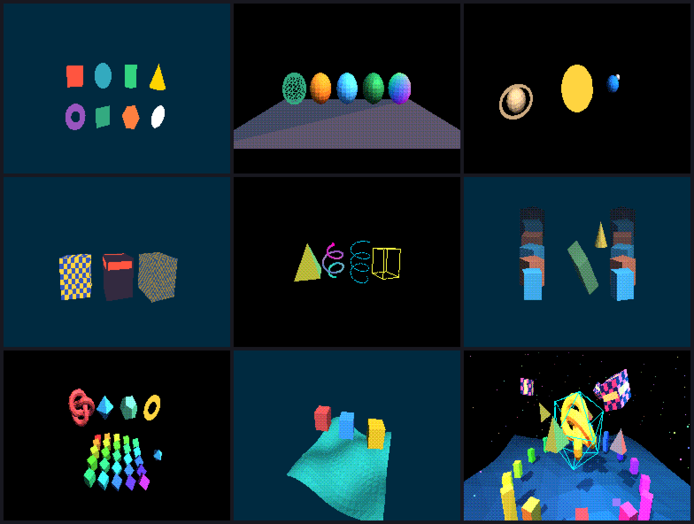
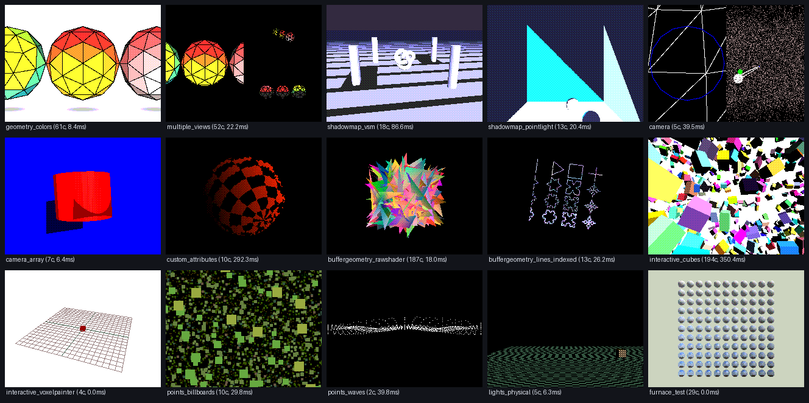

# pyxel-three

three.js の入門の書き方のまま、[Pyxel](https://github.com/kitao/pyxel) で 3D が動く遊び場です。
JavaScript のエンジンも WebGL も使わず、Python だけで動きます。

*A playground that runs three.js-style JavaScript on Pyxel, in pure Python. English below.*



> **非公式です。** three.js プロジェクトとは関係ありません。three.js の API のごく一部を、Python で書き直したものです。

## しくみ

```
three.js の書き方の JS ──> jsinterp.py   JS の小さなインタプリタ（自作）
                      ──> three.py     three.js の API の一部を Python で再実装
                      ──> render.py    numpy のソフトウェアラスタライザ
                      ──> Pyxel の画面（256×192、226 色）
```

- 色は、Pyxel の 16 色に 210 色（6×7×5 の色立方体）を足した 226 色を使い、4×4 の Bayer ディザで量子化しています。
- `ShaderMaterial` の GLSL も、自作のパーサーと numpy の評価器で動かします（`glsl.py`、`glsl_eval.py`）。
- `eval` / `exec` / `os` / `sys` などは使っていません。Pyxel の Web 版（Pyodide）や、外部ライブラリが制限された環境でも動くように作っています。

## 動かし方

```sh
pip install pyxel numpy pillow
python main.py
```

- 起動すると、three.js 公式マニュアルの最初の例（回る立方体）が動きます。
- `.html` か `.js` のファイルを Pyxel の画面にドロップすると、その中のスクリプトを実行します。
- テクスチャやモデル（`.png`、`.glb`、`.obj` など）は、HTML と一緒にドロップすると、ファイル名で読み込めます。
- ゲームパッドの A ボタンで、最初から実行し直します。

`pillow` は画像テクスチャを読むときだけ使います。

## サンプル

`examples/` に、外部ファイルなしで動くサンプルが 9 本あります。

| ファイル | 内容 |
|---|---|
| `01_primitives_gallery.html` | 基本の形 8 種 |
| `02_lights_and_materials.html` | ライトとマテリアル |
| `03_scene_graph_hierarchy.html` | 親子関係（太陽系） |
| `04_procedural_textures.html` | `DataTexture`、`CanvasTexture` |
| `05_lines_points_custom_buffer.html` | 線、点、自作の `BufferGeometry` |
| `06_ortho_fog_quat.html` | 平行投影カメラ、霧、クォータニオン |
| `07_instanced_and_complex_geo.html` | `InstancedMesh`、複雑な形 |
| `08_dynamic_verts_and_raycast.html` | 頂点の変形、レイキャスト、ドラッグ操作 |
| `megademo.html` | 全部入りのデモ |

three.js 公式サンプルの単体 HTML も、そのままドロップして試せます（公式サンプルはこのリポジトリには含めていません）。


*three.js 公式サンプルを、このポートで描いたもの*

## どこまで動くか

| 対象 | 動いた数 |
|---|---|
| three.js マニュアルのサンプル（画像などの素材あり） | 145 / 181（80.1%） |
| three.js マニュアルのサンプル（HTML 単体） | 115 / 183（62.8%） |
| three.js 公式の `examples/webgl`（HTML 単体） | 55 / 300（18.3%） |

「動いた」は、エラーなく最後まで実行できたという意味です。見た目が本家と同じとは限りません。

**対象外**：WebGPU / TSL、`DRACOLoader`、`KTX2Loader`、`UltraHDRLoader`、`THREEx` などの古い外部スクリプトに頼るサンプル。

**制限**：テクスチャは最近傍のサンプリングだけです。`MeshStandardMaterial` は近似で、本物の PBR ではありません。重いシーンでは、1 フレームに数十〜数百ミリ秒かかります。

## ファイル

| ファイル | 役割 |
|---|---|
| `main.py` | Pyxel のアプリ本体（ドロップ、入力、表示） |
| `jsinterp.py` | JavaScript のサブセットのインタプリタ |
| `three.py` | three.js の API の一部の再実装 |
| `render.py` | ソフトウェアラスタライザと色の量子化 |
| `glsl.py`、`glsl_eval.py` | GLSL のパーサーと評価器 |
| `gltf.py`、`obj.py` | glTF / OBJ の読み込み |

## ライセンス

MIT License（[LICENSE](LICENSE)）。`glsl.py` には three.js のシェーダーのコード（MIT、© three.js authors）が含まれています。

コードは AI が書き、haruka_apps が方針を決めて確認しました。

---

## English

**pyxel-three** runs three.js-style JavaScript on [Pyxel](https://github.com/kitao/pyxel), in pure Python, with no JavaScript engine and no WebGL.

> **Unofficial.** Not affiliated with the three.js project. It re-implements a small part of the three.js API in Python.

**How it works**: a small JavaScript interpreter (`jsinterp.py`) runs the program against a Python re-implementation of part of the three.js API (`three.py`), and a numpy software rasterizer (`render.py`) draws the scene to the Pyxel screen (256×192). Colours are the 16 Pyxel colours plus a 210-colour cube (6×7×5), quantised with a 4×4 Bayer dither. GLSL in `ShaderMaterial` is parsed and evaluated by `glsl.py` and `glsl_eval.py`. The code does not use `eval`, `exec`, `os` or `sys`, so it is meant to run in Pyxel's web version (Pyodide) as well.

**Run**

```sh
pip install pyxel numpy pillow
python main.py
```

The first example from the three.js manual (a rotating cube) starts right away. Drop a `.html` or `.js` file on the window to run its script. Textures and models dropped together with it are loaded by file name. Gamepad A restarts.

**Examples**: `examples/` holds nine self-contained HTML files (see the table above). Single-file official three.js examples can also be dropped as they are; they are not included in this repository.

**Coverage**: three.js manual samples with their assets: 145 / 181 (80.1%); manual samples as single HTML files: 115 / 183 (62.8%); official `examples/webgl` as single HTML files: 55 / 300 (18.3%). "Ran" means it ran without errors, not that it looks identical to three.js.

**Out of scope**: WebGPU / TSL, `DRACOLoader`, `KTX2Loader`, `UltraHDRLoader`, and samples that depend on old external scripts such as `THREEx`.

**Limits**: nearest-texel texture sampling only; `MeshStandardMaterial` is an approximation, not real PBR; heavy scenes take tens to hundreds of milliseconds per frame.

**License**: MIT ([LICENSE](LICENSE)). `glsl.py` includes three.js shader code (MIT, © three.js authors).

The code was written by AI; haruka_apps directed and checked it.
